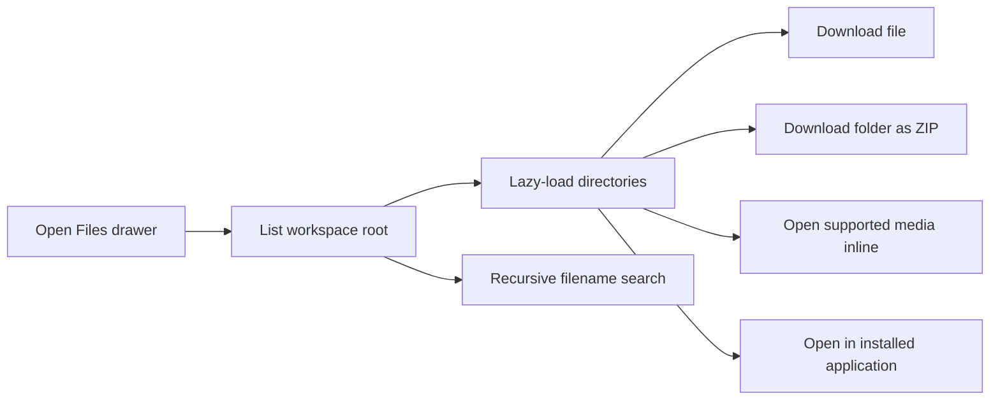

# File Manager architecture

## File manager

Install the [File Manager application](../README.md)
in the project to add its Files drawer, or install it globally from
**Settings → Applications** to add a copy to every existing project. Repeat the
global install to include projects created later. The drawer appears only while
that project's copy is installed and running.
Its drawer calls the installation's backend routes, which Remote admits only
for project members; each route runs the application's command in the project
container through `lxc exec`. Single files download through Remote's chat
download route.

The container command resolves paths inside the project's `/workspace` and
uses rooted filesystem operations to prevent symlink escapes. Listings and search results can report truncation rather
than returning unbounded data.

Selecting a file routes by type:

- supported image/audio/video/PDF opens in the full-screen media overlay;
- a running project application may register a file opener for text and code;
- when no opener is registered, those files download;
- archives and unsupported media download.

The same routing applies to validated absolute workspace links in chat. File
openers receive optional `:line[:column]` suffixes. Inline media receives a
restrictive content security policy.

