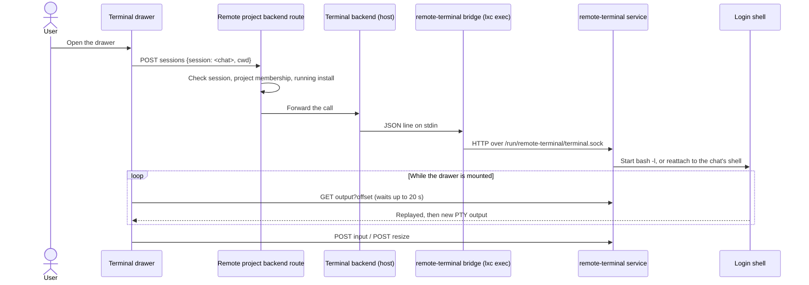

# Terminal architecture

## Terminal

The terminal is the installable [Terminal application](../README.md),
not a core route. Its shells run in the `remote-terminal` service inside the
project container, which answers only on a root-only Unix socket. The drawer
reaches it through ordinary
[application backend routes](../../../docs/dev/installable-applications/15-application-backends.md);
the backend relays them through one `lxc exec … remote-terminal bridge` process.

The drawer exists only for chats attached to a project in which the application
is installed and running. Each chat has one interactive `bash -l`, started in
the chat's directory under `/workspace`. On desktop the drawer is a resizable
pane beside the chat; its width is retained in browser `localStorage`. The
drawer and the Files, History, and Browser panes are mutually exclusive.

The shell belongs to the service, not to any request, bridge, or backend
process. A dropped connection, a reload, or a restart of Remote leaves it
running; the drawer reconnects while it is open and the most recent 256 KiB of
output is replayed. A shell nobody reads for 10 minutes is ended, and every
shell ends when the service stops. Remote does not start a stopped project or
installation for it.

Chats can still carry a `tmuxSession` and resolve their working directory from it; the backend no longer exposes routes to create, attach to, or send input to host tmux sessions.

