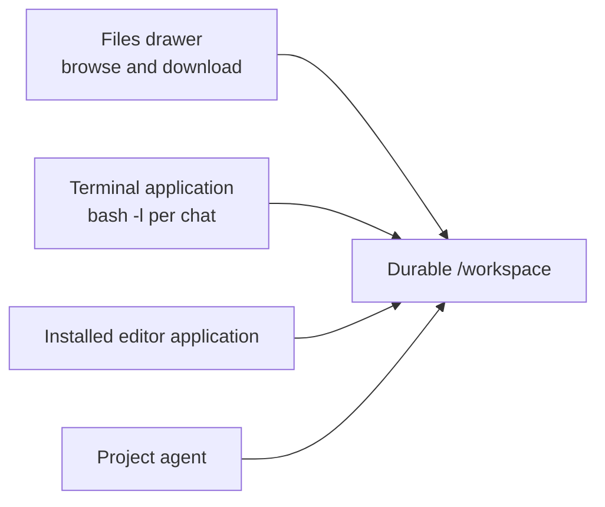

# Files, Terminal, and application editors

File Manager and Terminal are optional applications over the same project
workspace. Install them in the projects where you need browsing or shell
commands. Editor applications can add editing actions and file openers.

## Before you begin

- Open a chat inside the intended project. These workspace controls are not
  the isolation boundary for a **Loose chat**.
- Confirm the project is one you are allowed to change. Terminal and application
  actions can modify the durable workspace immediately.
- Remember that `/workspace` and the provider homes are durable, while
  arbitrary files elsewhere in the container root filesystem may disappear
  after container replacement.

## Choose the right surface

| Task | Surface | What it changes |
| --- | --- | --- |
| Browse directories, open media/code, or download a file | **Files** | Nothing unless an opened file is edited or a download is saved locally |
| Find a file by name | **Files** | Nothing |
| Download a directory as ZIP | **Files** | Creates a temporary server-side archive, then downloads it |
| Run a command or inspect a process | **Container terminal** (Terminal application) | Whatever the command changes |
| Read and edit a codebase | An installed editor application | Whatever the editor saves |

These tools start from the chat's current working directory. In a normal project
chat that is `/workspace`; a chat working in a contained subdirectory opens
that location where supported.

## Browse and download files

See the [File Manager usage](../../applications/file-manager/docs/usage.md).

## Open workspace links from chat

Validated absolute workspace links in an agent message follow the same split:
supported media opens in the in-app viewer; other safe files use a running
application's registered file opener or download. A path can include `:line` or
`:line:column`, which the opener receives.

Examples:

```text
/workspace/src/app.ts:42
/workspace/src/app.ts:42:7
```

Current inline media types are:

- images: `.avif`, `.bmp`, `.gif`, `.ico`, `.jpeg`, `.jpg`, `.png`, `.svg`,
  `.tif`, `.tiff`, and `.webp`;
- audio: `.aac`, `.flac`, `.m4a`, `.mp3`, `.oga`, `.ogg`, `.opus`, and `.wav`;
- video: `.m4v`, `.mov`, `.mp4`, `.ogv`, and `.webm`; and
- PDF: `.pdf`.

Path containment is checked server-side; an outside or traversal path is
rejected.

## Run a terminal command

See the [Terminal usage](../../applications/terminal/docs/usage.md).

## Open an application editor

Install an editor application in the project and use the action it adds to the
chat header. The application controls its own URL and file opening behavior;
Remote checks project membership and that the installation is running before
serving its declared web route. See the application's own guide for its editor
controls and settings.

## How the three paths meet



A change saved by the agent, terminal, or an editor is visible to the other surfaces
after refresh. The surfaces do not create separate copies or per-chat
worktrees.

## Related documentation

- [Projects and containers](../02-workspaces/03-projects-and-containers.md)
- [Workspace tools architecture](../02-workspaces/05-workspace-tools.md)
- [Git history and restore](08-git-history-and-restore.md)
- [Known limitations](../known-limitations.md)
- [Threat model](../threat-model.md)
