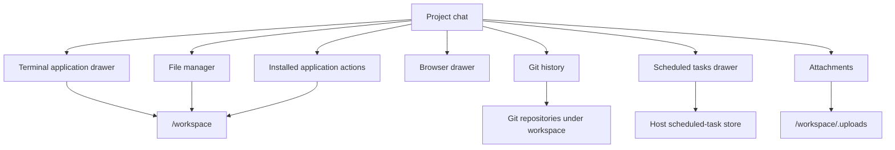
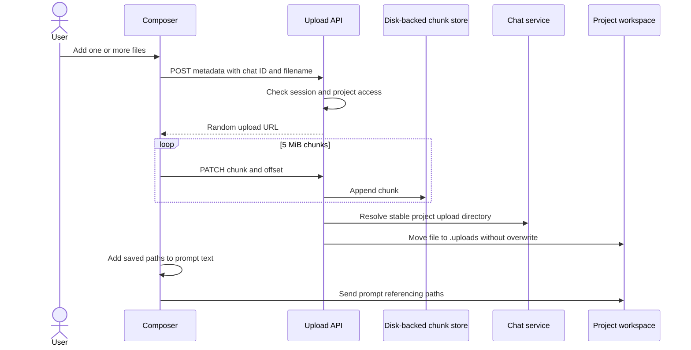
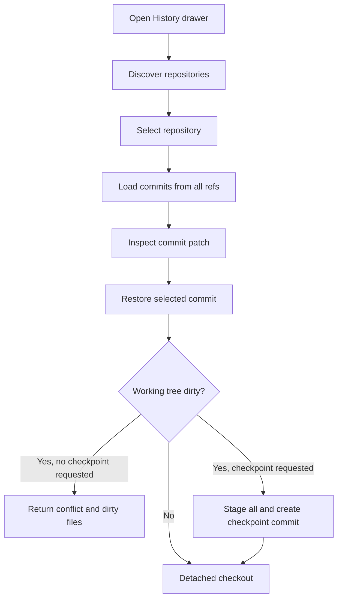

# Workspace tools

The chat header opens Git History, Browser, and installed application actions
and drawers, including File Manager, Terminal, and Scheduled Tasks. Most are views over the same project workspace; Schedules is a
host-control-plane view whose runs return to the same chat.

## Tool map

## Attachments

Files can be selected, dragged, or pasted into the composer. Uploads use the resumable tus protocol.

Important behavior:

- Default maximum upload size is 10 GiB and can be changed with `UPLOAD_MAX_BYTES`.
- Chunks live under the application data directory, not RAM-backed `/tmp`.
- Final files are mode `0644` and owned by the container-mapped root user.
- `.uploads/.gitignore` ignores every attachment.
- Existing filenames are not overwritten.

## File manager

See the [File Manager architecture](../../applications/file-manager/docs/architecture.md).

## Terminal

See the [Terminal architecture](../../applications/terminal/docs/architecture.md).

## Git history

The History drawer discovers Git repositories at the workspace root and up to a bounded depth, excluding heavy or generated directories.

Restore resolves the commit, optionally creates a safety checkpoint using the `remote.futrx` identity, and checks out the target in detached HEAD state. Git commands use an explicit safe directory and bounded timeouts.

The frontend checks for repositories when a ready chat opens and after each
run; **History** stays hidden until at least one exists. Commit patches render
as collapsible per-file cards with line numbers, hunks, change counts, and file
status badges, with raw-text fallback.

The checkout API supports the checkpoint message, but the current History drawer does not render the dirty-tree checkpoint form even though its component state is present. In the visible UI, commit or stash dirty work through Terminal or an installed editor, refresh History, and then switch. Clean-tree switching works directly.

## Scheduled tasks

See the [Scheduled Tasks workspace integration](../../applications/scheduled-tasks/docs/architecture.md).

## Application web routes and workspace links

Project applications can declare a web port in their manifest. Remote exposes a
running installation at `<label>--<project>.<host>` after checking
project access. It selects the upstream port from the validated application
manifest, removes platform cookies before forwarding, and stops routing when
the application stops or is uninstalled. The `/apps/<project-slug>/<application-id>/` launch URL redirects to that origin. The application owns its browser UI,
file URL format, and any chat actions it contributes.

Workspace links in chat are inspected by the frontend. Supported media uses
the authenticated `media-open` route and opens in the in-app viewer. For other
files, an installed application's file opener can supply a URL with optional
line and column. Without one, the file downloads.

## Code map

- Upload handler: [`backend/internal/transport/http/upload_tus.go`](../../backend/internal/transport/http/upload_tus.go)
- File Manager application: [`applications/file-manager/`](../../applications/file-manager/)
- Shared chat file retrieval: [`backend/internal/service/workspacefiles/service.go`](../../backend/internal/service/workspacefiles/service.go)
- Terminal application: [`applications/terminal/`](../../applications/terminal/)
- Extension drawer host: [`frontend/src/ui/chat/extensions/ExtensionDrawer.tsx`](../../frontend/src/ui/chat/extensions/ExtensionDrawer.tsx)
- Git history: [`backend/internal/service/githistory/service.go`](../../backend/internal/service/githistory/service.go)
- Application web routes: [`backend/internal/transport/http/handlers/applications_web_handler.go`](../../backend/internal/transport/http/handlers/applications_web_handler.go)
- Schedules UI: [`applications/scheduled-tasks/ui/`](../../applications/scheduled-tasks/ui/)
