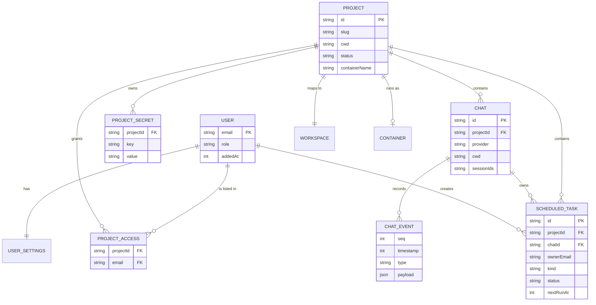
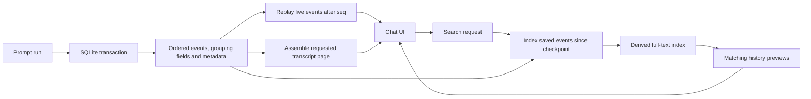
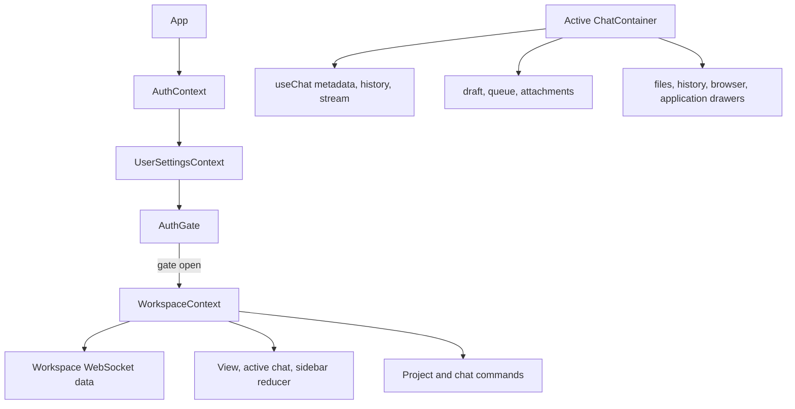
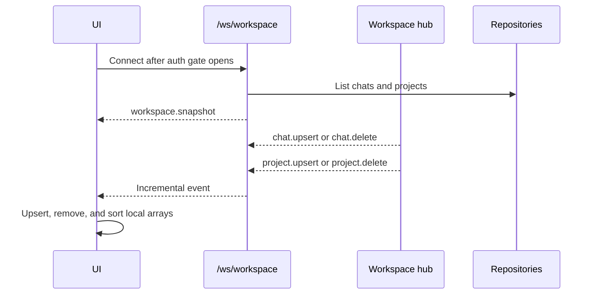

# Data and frontend state

The application does not use an external database service. Conversations use
an authoritative embedded SQLite database, including metadata, ordered events,
branches, native session bookmarks, indexed event grouping and a rebuildable
full-text search index. Other platform metadata remains in JSON files.
Project source files and native
harness state live in separate persistent host trees.

## Host storage layout

```text
/opt/remote.futrx/data/                 DATA_DIR
├── conversations.sqlite                authoritative conversation database
├── .conversations.lock                 backend/importer ownership lease
├── chats/<chat-id>/                     inactive legacy backup after migration
│   ├── meta.json
│   └── events.jsonl
├── projects/<project-id>/meta.json
├── projectaccess/<project-id>.json
├── projectsecrets/<project-id>.json
├── user-settings/sha256-<identity>.json
├── users.json
├── local-admin.json
├── oauth.json
├── smtp.json                           provider-neutral SMTP configuration; mode `0600`
├── agent-quota.json                    last reported plan windows per provider account
├── session.key
├── applications/data/<instance>/tasks.json  application-owned schedules and claims
├── application-turns/<instance-sha256>/<request-sha256>.json  generic agent execution receipts
└── uploads/tmp/                        tus chunks and sidecars

/var/lib/remote/projects/<slug>/
├── workspace/                          durable project files
│   ├── .env                             generated project secrets
│   ├── .uploads/                        chat attachments
│   ├── .browser-gui/                    browser launch assets and profile data
│   └── ...                              user source and generated files
└── agent-home/                         durable provider-owned state
    ├── codex/                           mounted at /root/.codex
    ├── minimax/                         mounted at /root/.minimax
    ├── claude/                          mounted at /root/.claude
    ├── kimi/                            mounted at /root/.kimi-code
    └── antigravity/                     mounted at /root/.gemini/antigravity-cli
```

Application `DataDir` holds workflow state: Scheduled Tasks stores its own
definitions, claims, retries, and acknowledgments there. The separate
`application-turns/` store holds accepted SDK requests and agent execution
results, with hashed paths, private files, and atomic writes. Receipts survive
stop/start, upgrades, and server restarts; uninstall removes them. Applications
save their results before `AgentTurns.Forget`, which removes the receipt and
retains chat history. A server restart makes unfinished receipts interrupted;
retrying the same request can run it again. See
[Application agent runtime](../dev/installable-applications/25-application-agent-runtime.md).

The host-wide credential sources use provider-owned paths in the host user's home. Credential synchronizers seed or update project-specific credential locations, primarily the mounted provider homes. Claude also requires `/root/.claude.json` outside its mounted home; that file survives replacement through host synchronization rather than the project mount.
When a chat selects a saved Claude or Codex account, its run uses a stable
`run-accounts/<scope>` subdirectory inside that provider home. The scope is a
hash of account, project, and the original native conversation identifiers.
Independent chats have separate homes; a native fork retains the source home
scope so its new session and later resumes can find inherited state. Shared
instructions, settings, and skills
remain linked from the canonical provider home.

## Entity relationships



A chat's project relationship is optional. Project membership is stored as normalized email strings rather than a database foreign key.

## Chat persistence



Chat metadata includes title, provider, provider session IDs, working directory, project ID, read markers, model/mode controls, selected skills, and fork state. The `running` flag and cancellation handle are computed from the in-memory run hub and are not persisted. Provider child processes may survive a backend restart, so the restarted control plane cannot automatically rediscover or cancel them.

Ordered SQLite events supply live reconnects. Indexed fields on each event
locate its turn and display item, using `turnId` or legacy `user` boundaries.
History reads assemble the requested items on demand and coalesce adjacent
streaming text/reasoning deltas. Cursors remain event sequences. The browser
initially requests up to 10 turns and older history in pages of up to 20 turns;
a byte budget can end a page within a large turn. Search catches up from saved
events separately from the message-save transaction.

Upgrades perform a one-time streaming migration while the old backend is
stopped. The new database must never be deleted as a cache: it is the source
of truth. Corruption fails closed, and no runtime path falls back to legacy
JSONL. The old offset database is removed after validated cutover. See
[conversation storage and migration](../dev/conversation-storage.md) for
schema ownership, resume checkpoints, backups and rollback compatibility.

Scheduled-task definitions live in each installed application’s host `DataDir`
as `tasks.json`. The application atomically persists definitions and active run
claims before emitting due messages. Claims are retried after a backend restart;
core acknowledges agent results. Stop/start and upgrades retain state; uninstall
removes it.

Rewind selects a new branch with a retained history prefix. Forks also share a
prefix rather than copying the full event log. Their next runs prefer a native
fork at a successful checkpoint retained in that history, then receive only
the missing suffix. Without a usable checkpoint, they start fresh with retained
history. Source native sessions stay intact, and workspace files are not rolled
back. Deleting a chat removes its active database
records; historical branches required by another fork must remain reachable.

## Agent quota snapshots

Subscription windows follow a separate path from the usage ledger. Claude's
adapter owns its stream normalization in `claude/quota.go`. Live Codex runs
use `codexharness/app_server_quota.go` for the `account/rateLimits/updated`
notifications the app server sends with every token count that carries rate
limits. Only the Codex product's recognized five-hour and seven-day durations
become plan windows; other products and durations are ignored, and a window
that an update leaves out keeps its last reading. A run never requests
`account/rateLimits/read` itself: the app server finishes in-flight requests
before it exits, so an unanswered read would delay the end of the turn.

The Usage tab also reads plan limits on demand, the way Claude Code's `/usage`
and Codex's `/status` do. Providers that can do this implement
`harness.PlanUsageReader`, and `harnessmodule.Runtime.PlanUsageReaders` lists them.
Claude's reader in `claude/plan_usage.go` runs the CLI headless and sends one
`get_usage` control request; Codex's in `codex/plan_usage.go` starts an app
server of its own and sends `account/rateLimits/read`. Each saved account is
read in a private CLI home made from its vault credential, one account at a
time, and a login the CLI refreshed is offered back through
`CaptureRunCredential`. The host login is read in place, and only while the
provider has no active saved account. No prompt or turn is sent.
MiniMax's reader calls `/v1/token_plan/remains` once for each saved Token Plan
key and uses the coding bucket's explicit remaining percentages. It does not
infer a percentage from the API's ambiguous count fields.

A plan belongs to one provider account. For a saved-account run, the Claude
and Codex adapters wrap the run's event callback with
`agentruntime.EmitForAccount`, which stamps the saved account ID on every
event. A run on a provider's current host login, which chats without a
pinned account use while no saved account is active, leaves `AccountID`
empty. The prompt service's run event relay
records `EventQuotaUpdated` through its `QuotaRecorder` contract with the
provider and account; quota events are not chat transcript events, and a
cancelled prompt still records readings that arrived before the cancel.
`service/harness/quota` owns the latest session and weekly readings per
provider account and lists them by provider and then account ID. It keys
readings only by account ID; which saved accounts exist and what they are
called stays with the saved-account service. Its `Refresh` asks every plan
reader at most once per `PlanUsageRefreshInterval`; callers within the
interval, or while a read runs, share one answer, and the read continues,
bounded by `PlanUsageReadTimeout`, after a caller stops waiting. A live answer
replaces the account's windows. A failed read keeps them and records why; that
error is kept in memory only and returned beside the account.

`stores/fileagentquota` persists `{"accounts": [...]}` to
`DATA_DIR/agent-quota.json` using a mode-`0600` temporary file and rename.
Updates and their synchronous, best-effort writes are serialized so an older
save cannot overwrite a newer snapshot. Reads use a separate lock and do not
wait for file writes. Inputs, loaded data, saved snapshots, and returned views
have independent window and percentage values. Missing or unreadable
snapshots, including files from before readings were kept per account, load
as empty and do not prevent startup. Without a repository, readings remain
available for the lifetime of the process.

`GET /api/agent-quota` calls `Refresh` and then returns the view to signed-in
users, or without a session when application authentication is disabled.
Responses are not cached. In the frontend, `agentQuotaApi` validates the
response and `models/agentQuota.ts` describes its data. The Usage section's
`usePlanQuota` hook owns a serialized refresh every 15 seconds after the
previous request settles, with a 45-second request timeout and cancellation
on unmount. A failed refresh retains the last successful snapshot; a
successful empty response clears it. Its adjacent `planQuotaState` projection
joins readings with the agent-auth catalog from `AuthContext`. Each saved
account that has reported a window, or whose latest read failed, is listed in
catalog order with its label, email, plan type, active flag, and error. While
no saved account is active, the current login's reading is listed too, under
the provider heading when it is the only plan and as "Current login" beside
saved accounts; once an account is active it is hidden. A removed account's
reading is never shown.
The projection builds display contracts in `models/planQuota.ts` from
`config/planQuota.ts`: each provider's window labels and measure, as its CLI
prints them (Claude's floored percentage used, Codex's and MiniMax's rounded
percentage left), tones, and thresholds. Missing percentages stay absent, so a
status-only window never acquires a zero-percent bar. A reported zero has zero
bar width, and bars are capped at 100%. Reset times are absolute in the
viewer's time zone, with the date only when the reset is not today, and an
expired reset is marked as awaiting a new reading. A reading says how old it
is only once it is five minutes old. Ages and reset countdowns advance every
15 seconds even if refreshes fail.

## Project persistence

Project metadata and workspaces are separate:

- `data/projects/<id>/meta.json` stores identity, slug, container name, status, order, resource overrides, and timestamps.
- `/var/lib/remote/projects/<slug>/workspace` stores durable project content.
- `/var/lib/remote/projects/<slug>/agent-home/*` stores durable provider configuration, authentication, and session state.
- `/var/lib/remote/projects/<slug>/agent-home/minimax` stores the isolated
  Codex-harness catalog and MiniMax sessions; the host injects the managed key
  only when starting MiniMax.
- `/var/lib/remote/projects/<slug>/agent-home/antigravity` stores durable
  Antigravity state and is mounted at `/root/.gemini/antigravity-cli`.
- Access and secrets use separate mode-`0600` files.
- Metadata writes use a temporary file and rename where implemented.

## Authentication and settings persistence

| File | Content |
| --- | --- |
| `local-admin.json` | Local administrator email and password hash |
| `oauth.json` | Google OAuth client ID and secret |
| `smtp.json` | Provider-neutral SMTP configuration (host/port/TLS/auth, sender address); mode `0600` |
| `agent-api-keys.json` | Legacy singleton provider API keys; MiniMax entries are migrated into named accounts; mode `0600` |
| `agent-accounts.json` | Saved Claude/Codex subscription credentials and MiniMax Token Plan keys, grouped by provider with an active/default account ID; mode `0600`; credentials are never returned by the API |
| `session.key` | Random key used to sign platform sessions |
| `users.json` | Registered emails, roles, inviter, and timestamps |
| `user-settings/sha256-*.json` | Theme and default chat provider/model/mode/reasoning/tier |

The user-settings filename hashes the authenticated identity key so an email or subject is not used directly as a path.

## Frontend state ownership



| State | Lifetime |
| --- | --- |
| Authentication and user settings | Preact context; reloaded from HTTP after page reload. Host-chat and project-chat preferences each retain the last provider/account/model selection. |
| Agent auth registry | Ordered `GET /api/agent-auth` snapshot in `AuthContext`, updated by one normalized WebSocket per managed provider |
| Projects and chat summaries | Workspace WebSocket; server is authoritative. A chat created or forked from this client is seeded into the list on the create response so the new selection holds until its `chat.upsert` arrives |
| Active view, selected chat, sidebar open state | In-memory reducer |
| Chat events | Initial HTTP page plus reconnecting WebSocket updates |
| Composer drafts and queued prompts | In-memory map mirrored to per-tab `sessionStorage`, keyed by chat ID |
| Agent capability catalog | Last response in page memory, keyed by normalized user plus host/project scope; backend process memory owns TTL freshness |
| Service-worker offline cache | Only the versioned, self-contained `/offline.html`; navigation and application data remain network-first |
| Frontend build | Page's own stamp from `<meta name="remote-build">`; the served stamp from `/build.json` in `frontendBuildStore`. `useFrontendBuildSync` reloads onto a newer build (see [deployment](../04-operations/09-deployment-and-operations.md#frontend-build-after-a-deploy)). The last build this tab reloaded for is kept in per-tab `sessionStorage`. |
| Browser drawer width | Browser `localStorage` |
| Answered interactive question state | Browser storage used by the question renderer |

## Agent capability cache ownership

Agent models and their dependent controls are runtime discovery data, not
durable application records. The backend keeps one process-local entry for the
host and one for each project ID plus current container name. Live,
warning-free catalogs expire after 24 hours; a fallback or warning anywhere in
the catalog reduces its TTL to 2 hours. Expiry is lazy, manual refresh replaces
the entry, and a backend restart clears all entries. Overlapping requests for
one scope share a single discovery operation.

The frontend store holds the last response per normalized user and scope only
in the current page. It leaves that response visible while requesting the
backend and coalesces duplicate page-level requests, but it neither persists
the catalog nor decides when backend data is fresh. A managed provider's
authenticated flag changing, or a login reaching completed with a new start
revision, requests refreshes for currently subscribed scopes; intermediate
login-status changes do not. The sidebar's project **Start** action requests
one for that project, while the Project workspaces lifecycle actions do not. A
request already in flight remains coalesced. Terminal-driven changes such as
Antigravity sign-in require the user to choose **Refresh models**.

The capability payload also exposes immutable module metadata alongside live
CLI discovery: execution scopes, authentication mode and instructions,
resume/fork support, skill strategy, and browser/application-tool feature flags.
This metadata is decorated from the validated backend module catalog; it does
not originate from provider CLI output.

## Workspace synchronization



The initial snapshot is filtered to permitted projects for members. Current live workspace hub events are broadcast to every connected workspace subscriber without another per-event membership filter; protected resource reads still perform their own access check.

## Current deletion behavior

| Delete action | Data removed |
| --- | --- |
| Delete chat | Chat metadata and event log; active run is canceled first |
| Delete chat | Does not cascade-delete scheduled tasks; a later fire moves the orphaned task to an error state |
| Delete project | Container, project metadata, host project root containing workspace and provider homes, access list, and secrets |
| Delete project | Does not currently cascade to separate chat records that reference it |
| Delete secret | Authoritative secret entry; removal from generated `.env` and LXD environment is attempted best-effort, so stale copies are possible on sync failure |
| Delete user | User-directory entry; project access records are not globally swept |
| Stop Agent Browser | Processes stop; persistent profile remains in the workspace |

## Code map

- Store composition: [`backend/internal/stores/stores.go`](../../backend/internal/stores/stores.go)
- Chat store: [`backend/internal/stores/sqlitechat/store.go`](../../backend/internal/stores/sqlitechat/store.go)
- Project store: [`backend/internal/stores/fileproject/store.go`](../../backend/internal/stores/fileproject/store.go)
- Scheduled-task persistence and clock: [`applications/scheduled-tasks/backend/api/`](../../applications/scheduled-tasks/backend/api/)
- Workspace context: [`frontend/src/state/context/WorkspaceContext.tsx`](../../frontend/src/state/context/WorkspaceContext.tsx)
- Workspace data hook: [`frontend/src/state/hooks/workspace/useWorkspaceData.ts`](../../frontend/src/state/hooks/workspace/useWorkspaceData.ts)
- Per-tab composer persistence: [`frontend/src/state/stores/chat/composerSessionStore.ts`](../../frontend/src/state/stores/chat/composerSessionStore.ts)
- Frontend build sync: [`frontend/src/state/hooks/server/useFrontendBuildSync.ts`](../../frontend/src/state/hooks/server/useFrontendBuildSync.ts), [`frontend/src/state/hooks/server/frontendBuildReloadState.ts`](../../frontend/src/state/hooks/server/frontendBuildReloadState.ts), [`frontend/src/state/stores/server/frontendBuildStore.ts`](../../frontend/src/state/stores/server/frontendBuildStore.ts), and the stamp plugin in [`frontend/vite.config.ts`](../../frontend/vite.config.ts)
- Scheduled-task UI: [`applications/scheduled-tasks/ui/`](../../applications/scheduled-tasks/ui/)
