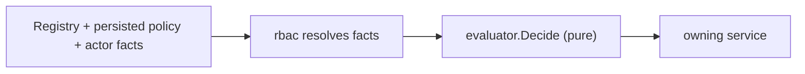

# Permissions

`internal/rbac` decides whether an existing authenticated user may perform a
registered action. Authorization happens **inside the service that owns the
operation**, never in an HTTP handler. Administrators are the root policy: they
are allowed everything, and no stored record can remove that.

## Vocabulary

| Term | Meaning |
| --- | --- |
| **Actor** | Who is acting: a human identified by normalized email, or the trusted system. Carried in `context.Context`; a missing actor is never the system. |
| **Resource / scope** | What the action applies to: `platform` or `project:<id>`. Matching is exact, so a platform record never applies to a project, and project A never applies to project B. |
| **Definition** | A permission declared in code: key `<context>.<resource>.<action>`, supported scope kinds, a baseline, and whether it is delegable. There is no runtime way to create one. |
| **Role** | A persisted bundle of `(permission, effect)` rules. Independent of `user.User.Role`. |
| **Assignment** | A direct `allow` or `deny` of one permission to one user at one scope. |
| **Binding** | Attaches a role to a user at a scope. Every rule in the role must support that scope kind. |
| **Baseline** | The code-owned rule used when nothing matches (`none`, `admin`, `project-member`, `authenticated`). It preserves access that predates the permission. |

## Data model

```go
// Actor: the principal making the request.   (actor.go)
Actor{Email string, system bool}

// Scope: what the action applies to.         (models/definition.go)
Scope{Kind ScopeKind, ID string}

// Definition: a registered permission (code-only).   (models/definition.go)
Definition{Key, Description, Scopes []ScopeKind, Baseline, Delegable bool}

// Role: a reusable bundle of rules — a template, not a user record.  (models/state.go)
Role{ID, Name, Description, Rules []{Permission, Effect}}  // plus bookkeeping fields

// Assignment: one direct allow or deny.   (models/state.go)
Assignment{UserEmail, Permission, Scope, Effect}           // plus bookkeeping fields

// RoleBinding: attaches a role to a user at a scope.   (models/state.go)
RoleBinding{UserEmail, RoleID, Scope}                      // plus bookkeeping fields
```

A **Role** is a template; what a user holds comes from their **Bindings** and **Assignments**.

## Layout

```
rbac/models      vocabulary and persisted records; imports no RBAC package
rbac/evaluator   pure Decide(definition, policy, facts, check); imports only models
rbac             registry, ports, orchestration, mutations, audit; facade in models.go
stores/filepermissions   permissions.json + audit log, depends on rbac contracts only
cmd/remote/main.go       the only place that knows every concrete type
```

`Decide` does no I/O. `rbac` resolves the facts first (actor, administrator,
registered, and project membership when the decision needs it) from the
`IdentityDirectory` and `ProjectMembership` ports, loads the current policy on
every check (no caching), then calls `Decide`.



## Evaluation order

1. No actor: `ErrActorRequired`. Unregistered permission or unsupported scope:
   an error. Anything that cannot be resolved fails closed.
2. System actor: allow.
3. Administrator: allow.
4. Not a registered user: deny.
5. Any matching **deny** (assignment or bound role rule): deny.
6. Any matching **allow**: allow.
7. The definition's baseline.
8. Default deny.

`Require` returns the stable `ErrDenied` and never says which record decided.
The structured `Decision` is for logs and tests.

## Add a permission

1. Declare it in the owning service's `permissions.go`
   ([example](../../backend/internal/service/project/permissions.go)). Default to
   `BaselineNone`; mark `Delegable` only if a holder may hand it on.
2. Add the group to `permissionDefinitions()` in
   [`cmd/remote/main.go`](../../backend/cmd/remote/main.go).
3. Enforce it. The service takes the narrow `Authorizer` port and binds the
   permission once in its constructor, after options are applied:

   ```go
   service.requireLifecycle = bind(service.authorizer, PermissionLifecycleManage)
   // ...
   if err := s.requireLifecycle(ctx, id); err != nil { return Meta{}, err }
   ```

   Authorize first, before any lookup. A service built without an authorizer
   must fail closed (the project default admits only the system actor).

Renaming a key needs a stored-record migration first.

## Supplying the actor

- The auth middleware attaches `UserActor(session.Email)` from the session only.
- Trusted internal work calls `ContextWithSystemActor(ctx)`.
- Every caller of `ContextWithSystemActor`, `SystemActor`, and `ContextWithActor`
  is allowlisted in
  [`architecture_test.go`](../../backend/internal/rbac/architecture_test.go);
  adding one puts it in review.

## Testing

See [`permissions_test.go`](../../backend/internal/service/project/permissions_test.go)
and [`project_membership_routes_test.go`](../../backend/internal/transport/http/handlers/project_membership_routes_test.go)
for working examples. Attach an actor with:

```go
ctx := permission.ContextWithActor(context.Background(), permission.UserActor("member@example.com"))
```

- **allow**: inject `allowAllAuthorizer{}` for tests not about authorization.
- **deny**: inject `&recordingAuthorizer{err: permission.ErrDenied}` to verify denial and that no side effect runs.
- **administrator**: pass `permission.ContextWithSystemActor(ctx)` — the system actor is always allowed.
- **system and no actor**: a service without an injected authorizer admits only the system actor; an anonymous context returns `ErrActorRequired`.

Tests not about authorization can inject an allow-all Authorizer and ignore the permission path entirely.

## Delegation

`permissions.assignments.manage` and `permissions.roles.manage` (platform scope,
not delegable) gate policy changes. A non-administrator holding one may only
assign or bind what is `Delegable` **and** held by them at the same scope, and
checks run against the snapshot held under the store lock. Targets must exist
in the user directory. Idempotent mutations write and audit nothing.

## Composition and persistence

`main.go` builds auth, the adapters, then RBAC, then calls `service.New` with
both injected. Auth reads users through a view without removal cleanup (cleanup
needs the project service, which needs authorization, which needs auth);
`service.New` builds the user service that keeps cleanup.

`DATA_DIR/permissions.json` (schema-versioned, atomic writes) holds the policy;
`permission-audit.jsonl` records every mutation before it is published. At
startup an absent file is an empty policy; corruption or an unregistered key
refuses to start. Removing a user deletes their assignments and bindings.

## Architecture rules

[`architecture_test.go`](../../backend/internal/rbac/architecture_test.go)
asserts that models import no RBAC parent, the evaluator imports only models,
`filepermissions` imports only rbac contracts, the permission domain does not
import auth, user, project, chat, stores, or transport, enforcing services do
not import concrete auth, transport, or stores, only allowlisted files mint
actors, and nothing creates a permission definition at runtime.

## Integrated capabilities and administration

The canonical policy API is `/api/admin/permissions/*`, with lowercase JSON
fields. It includes definitions, roles, assignments, bindings, `accounts`
(manager-only account targets), and `effective` (the current actor's decisions
at platform scope or `?projectId=<id>`). Effective decisions never expose policy
records or another actor's decisions. The frontend uses
`usePermissionAdministration` for policy edits and `useEffectivePermissions`
for action hints; services always enforce authorization again.

The registry now also owns project and host-chat creation, project-chat creation
and forks, project controls/secrets, workspace files/Git/browser/Terminal, IDE
access, provider account management and provider account use. The current
Code Server and Terminal application gateway gates launch redirects, direct
requests and WebSocket admission. Preview access to their ports (8842 and 8843),
and browser ports (6080 and 9222), uses the same permissions and cannot use public
preview grants to bypass those checks. Project membership remains required.
The removed core host shell and core scheduler are not restored.

## Provider account grant provisioning and rollback

`agents.account.use` has **no member baseline**. Administrators retain recovery
access; members must receive explicit assignments or role bindings for exact
`provider-account` scopes such as `claude:work`, `codex:team`, or
`codex:default`. `default` means legacy host login when no saved default exists.
When a saved active account exists, an empty account selection resolves to that
account's ID and requires its grant; granting `default` does not grant every
account. A denied explicit account never falls back to another login. Denies
continue to outrank member grants under the canonical evaluator's existing
administrator recovery rule. The administration form lists available account
scopes and accepts validated scope identifiers.

Before deploying, provision grants for each intended user/account pairing.
Inventory direct assignments and role bindings, including scheduled-task owners.
Do not mass-grant all members access to all accounts. Current Scheduled Tasks
remain an application: the platform revalidates its captured owner and membership
at execution, and prompt/credential admission checks that owner's account grant.
Audit entries correlate application instance/request, run, project and account.

An older binary does not recognize these permission keys or the
`provider-account` scope and can refuse to load the persisted policy. Before a
rollback, back up the policy and its mandatory mutation audit, then remove newer
assignments/bindings and affected role rules using a binary that understands
them. Confirm that every remaining key and scope exists in the target binary.
Do not hand-edit a live policy or weaken validation to force an old binary to
start. Restoring an older policy snapshot also discards subsequent revocations;
reconcile those revocations before restoration.

## Audit contracts

The operational trail is separate from `permission-audit.jsonl`. Operational
recording is best effort: storage failure is logged and does not reject an
otherwise valid business operation. Permission mutations retain the foundation's
required audit-before-publication contract: failure rejects the policy mutation.
Operational audit filtering and export support actor, action, target, time and
project. Instrumentation records identifiers and outcomes rather than prompt
content or credential bytes; agent/account errors use fixed audit messages.

## Known limitations

- Existing WebSockets are not terminated when a grant is revoked. New requests
  and subsequent handshakes re-evaluate current policy. An active editor or shell
  session can continue until its connection ends.
- Upload capability and membership are checked at admission. Existing tus upload
  IDs retain the upstream in-flight upload behavior; chunk requests are not
  retroactively revoked.
- Handler-level administrator gates still apply ahead of some service checks.
- Project existence is not validated when assigning at `project:<id>`.
- Permission hints in the frontend refresh on focus, mutations and a 30-second
  interval. They are not an enforcement boundary.
