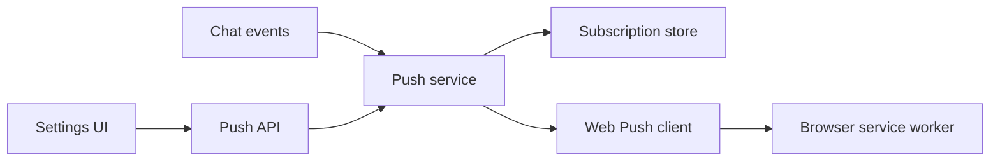

# Components and state

These are the main parts of the notification system and what each one does.

## Responsibilities

| Part | Responsibility |
| --- | --- |
| Settings UI | Shows whether notifications are supported, allowed, and enabled, plus test results and errors |
| Push API | Checks who the user is, registers devices, and records which chat they are viewing |
| Push service | Chooses who to notify and sends alerts to their devices |
| Subscription store | Saves the VAPID key and each user's browser subscriptions |
| Web Push client | Encrypts notification data and connects safely to push providers |
| Service worker | Shows notifications and opens the app when one is selected |

## State locations

| State | Location | Lifetime |
| --- | --- | --- |
| VAPID key pair | `DATA_DIR/webpush-vapid.json` | Until the keys are replaced |
| Browser subscriptions | `DATA_DIR/push-subscriptions/` | Until notifications are turned off, the subscription is retired, the user signs out, or the user is removed |
| Reports of which chat the user is viewing | Backend memory | Reports last 55 seconds; stored revisions per user are limited |
| Unanswered questions used by push notifications | Backend memory | Until answered or canceled; legacy questions remain after the turn finishes |
| Question batches marked for notification | Backend memory | Until a new user prompt, chat deletion, or failed delivery |
| Pending question IDs and legacy question status | Chat metadata on disk | Until answered, canceled, replaced by a new turn, failed, interrupted, or rewound |
| Browser permission and subscription | Browser profile | Controlled by the browser and user |
| Each account's notification preference for this browser | `localStorage`, `remote.futrx.pushOptIn` (SHA-256 fingerprints, not email addresses) | Until the account turns notifications off or signs out |

When Remote starts, it loads or creates the VAPID key, checks the key pair, and
sets up the Web Push client. If this fails, notifications are turned off and
the rest of Remote starts normally.

A chat's `awaitingAnswer` status works even when push notifications are off.
When a question needs an answer, the sidebar and chat header show a solid dot
in the app's accent color, labeled "Needs your answer," in place of the usual
working or unread indicator. Reading the chat does not answer its questions.
If there are several pending input requests, the dot stays until all of them
are resolved. Approval and permission requests do not turn it on.

Reloading the browser restores the waiting status from saved chat metadata.
Native input requests can only be answered while their agent run is active.
After the backend restarts, these requests are hidden. Legacy `AskUserQuestion`
keeps its waiting status after a successful turn because the answer starts a
new prompt.
Forked and rewound chats start without pending question state.

## Main source locations

- [`backend/internal/service/push_notifier.go`](../../../backend/internal/service/push_notifier.go)
- [`backend/internal/service/chat_notification_state.go`](../../../backend/internal/service/chat_notification_state.go) tracks pending questions and prevents duplicate or unnecessary alerts in memory.
- [`backend/internal/service/push/`](../../../backend/internal/service/push/)
- [`backend/internal/integration/webpush/`](../../../backend/internal/integration/webpush/)
- [`backend/internal/stores/filepush/`](../../../backend/internal/stores/filepush/)
- [`frontend/src/api/pushSubscriptionApi.ts`](../../../frontend/src/api/pushSubscriptionApi.ts)
- [`frontend/src/api/pushDeviceRegistration.ts`](../../../frontend/src/api/pushDeviceRegistration.ts)
- [`frontend/src/api/pushSubscriptionOwnership.ts`](../../../frontend/src/api/pushSubscriptionOwnership.ts)
- [`frontend/src/services/push/pushDeviceOptInService.ts`](../../../frontend/src/services/push/pushDeviceOptInService.ts)
- [`frontend/src/state/stores/push/pushPresenceStore.ts`](../../../frontend/src/state/stores/push/pushPresenceStore.ts)
- [`frontend/public/sw.js`](../../../frontend/public/sw.js)
