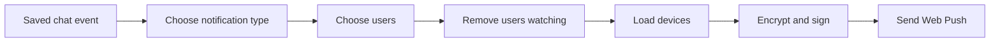

# Event-to-delivery pipeline

Remote uses saved chat events to decide when to send notifications. This covers
interactive runs, work started by applications, legacy scheduled runs, and
run recovery.

## Event classification

| Saved event | Result |
| --- | --- |
| `AskUserQuestion` starts | Urgent question notification |
| `interaction_request` with `status=user_input` | Urgent question notification, including Codex and MiniMax |
| Interactive `complete` | Turn-finished notification |
| Interactive `error` | Run-failed notification |
| Application `complete` or `error` (`applicationId` present) | Application result notification with neutral wording |
| Legacy scheduled `complete` or `error` (`scheduledTaskId` present, no application origin) | Legacy scheduled-task notification |
| Other event | No notification |

When a run stops after `AskUserQuestion`, Remote skips the next completion or
error notification. This keeps it from replacing the question alert in the
notification tray.

A structured input request can contain several questions. Remote uses their
text as the notification body, with a limit of 200 characters and 240 UTF-8
bytes. If the text is missing or invalid, it uses "Open the chat to answer the
question." Questions marked secret are left out.
Repeated events with the same turn/request or tool IDs share one alert. A new
question batch can send another alert even if an older notification is unread.
If delivery fails, Remote clears that batch's delivery record.

An `interaction_resolved` event that answers a matching question marks it as
answered and lets the same run continue. When the run finishes, it can send a
normal completion notification. Resolving a request for another
reason does not count as answering it: if the question is unanswered, the next
completion or error notification is still skipped. Errors marked for retry
also keep the question pending and leave its alert in place.

When an agent asks a question in its normal reply, it uses the existing
`<notification_summary>` block to say what input it needs. The notification
keeps the normal completion title, priority, and rules for unread alerts.
The instructions for adding this block live in the agent instruction files;
Remote does not add them to each prompt. If a run has no such instructions and
the agent sends no summary, Remote uses the default completion body.
Questions in normal replies do not set `awaitingAnswer`, because Remote has no
structured request and answer to track.

An `applicationId` means an application started the work; it does not mean the
work was scheduled. Scheduled Tasks and other applications use the same
notification type. A `user` event started by an application does not reset the
unread-notification state: automated work does not mean someone read the chat.

## Audience

- A project chat notifies its members and administrators.
- A chat without a project notifies every registered user.
- Old project access records are ignored if the email no longer belongs to a
  registered user.
- Each email address is included once.
- Anyone viewing the chat is skipped before Remote looks up their devices.

## Delivery

Remote converts the notification to JSON once, then sends it to each remaining
user's registered devices. `webpush-go` encrypts the data and builds the VAPID
request. Remote supplies the safe HTTP client and checks the response.

| Result | Action |
| --- | --- |
| `2xx` | Save the time of the successful send |
| `404` or `410` | Delete the subscription that is no longer valid |
| Other error | Log the failure and keep the subscription |

Question notifications use high urgency and a one-hour TTL. Other
notifications use normal urgency and a 12-hour TTL.

## Forked chats

Forking copies the chat's full visible history into the new chat. Copied events
are marked as history, so they still update storage and the workspace, but do
not send notifications.

## Current delivery gaps

- Devices are contacted one at a time, with one shared 30-second deadline.
- There is no queue with a fixed size limit, and delivery does not retry `429`
  or temporary `5xx` responses.
