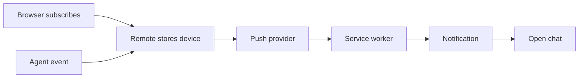

# Push notifications developer guide

This guide explains how Remote sets up notifications on a device, sends alerts
through Web Push, skips alerts you don't need, and opens the right chat when
you select a notification.

## Complete flow

The system has two parts:

- **Setup:** the browser creates a push subscription and Remote saves it for the
  signed-in user.
- **Delivery:** when an agent asks a question, finishes a turn, or fails, Remote
  sends an encrypted notification to that user's devices.

## Documents

| Document | Explains |
| --- | --- |
| [Components and state](01-components-and-state.md) | The main parts and where their data is kept |
| [Device subscription lifecycle](02-device-subscription-lifecycle.md) | Turning notifications on and off |
| [Event-to-delivery pipeline](03-event-to-delivery-pipeline.md) | How an agent event becomes a notification |
| [Presence, display, and click routing](04-presence-display-and-click-routing.md) | Skipping unnecessary alerts and opening chats |
| [Security and failure model](05-security-and-failure-model.md) | How outgoing requests are protected and what can go wrong |

## Notification types

| Event | Notification |
| --- | --- |
| Agent calls `AskUserQuestion` or sends a structured input request | The agent needs an answer |
| Interactive turn finishes | Turn finished |
| Interactive run fails | Run failed |
| A turn started by an application finishes or fails | Application result, including Scheduled Tasks |
| A legacy scheduled run finishes or fails | Legacy scheduled task result |
| User selects **Send a test** | Test notification |

Each title ends with an emoji so you can recognize the status at a glance.
Agent titles include the project name, or `Remote` when the name is unavailable.

| Status | Title |
| --- | --- |
| Needs an answer | Project - Agent needs your answer ❓ |
| Turn finished | Project - Agent finished ✅ |
| Run failed | Project - Agent encountered an error ❌ |
| Settings test | Notifications are working 🔔 |

Applications and legacy scheduled runs use the same success and error titles.
If the agent asks a question in its normal reply and ends the turn, the title
still says "Agent finished." Only structured question requests use "Agent needs
your answer."
